# Тренажер клавіатури

Портабельний офлайн-тренажер сліпого друку українською та латиницею для Windows 10 і 11.
Один файл розміром менше мегабайта: нічого не встановлює, працює без інтернету, зберігає все поруч із собою.

**[⬇ Завантажити Keybrd.exe](https://github.com/velmyshanovnyi/keybrd/raw/main/dist/Keybrd.exe)** — завжди остання збірка. Номер версії: [`dist/version.txt`](dist/version.txt).

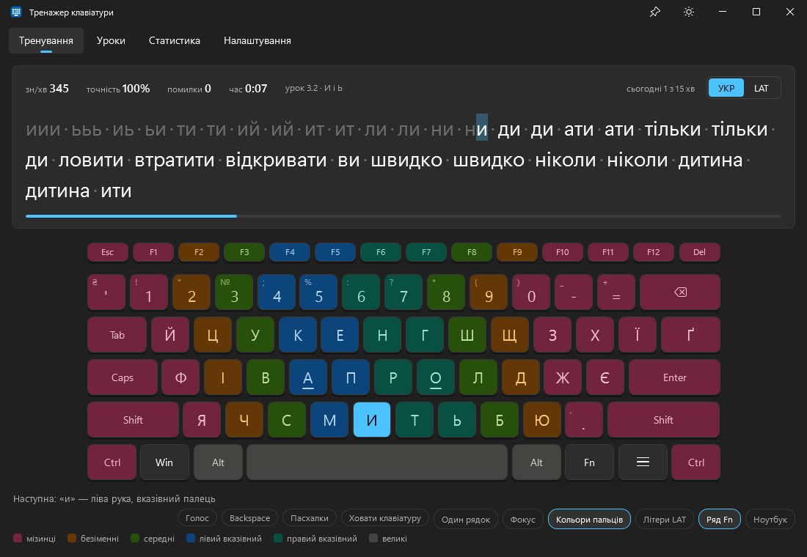

## Зміст

- [Швидкий старт](#швидкий-старт)
- [Вікно програми](#вікно-програми)
- [Кнопки під клавіатурою](#кнопки-під-клавіатурою)
- [Уроки і практика](#уроки-і-практика)
- [Режими набору](#режими-набору)
- [Розумне навчання](#розумне-навчання)
- [Перевірка себе](#перевірка-себе)
- [Пасхалки](#пасхалки)
- [Статистика](#статистика)
- [Налаштування](#налаштування)
- [Гарячі клавіші](#гарячі-клавіші)
- [Файли, інтернет і приватність](#файли-інтернет-і-приватність)
- [Збірка з коду](#збірка-з-коду)
- [Ліцензія](#ліцензія)

## Швидкий старт

1. Завантажте `Keybrd.exe` за посиланням вище й покладіть у будь-яку папку або на флешку.
2. Запустіть. Потрібен лише .NET Framework 4.8, який уже є у Windows 10 (1903+) і Windows 11.
3. Windows може попередити, що файл завантажено з інтернету й видавець невідомий: exe не підписаний. Натисніть «Докладніше» → «Виконати в будь-якому разі».
4. Відкриється вкладка «Тренування» з першим уроком. Покладіть вказівні пальці на клавіші з рисками (А і О) і друкуйте те, що написано зверху.
5. Якщо ви вже трохи друкуєте — відкрийте «Уроки» → «Вступний тест», він пропустить знайоме.

Щоб оновитись, замініть файл новим — налаштування й статистика лишаться.

## Вікно програми

Угорі чотири вкладки: **Тренування**, **Уроки**, **Статистика**, **Налаштування**.

У правому куті заголовка — кнопки вікна:

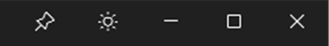

| Кнопка | Що робить | Клавіші |
|---|---|---|
| 📌 шпилька | закріплює вікно поверх усіх інших: воно не ховається, коли ви відкриваєте інші програми. Закріплена шпилька світиться кольором акценту. Стан запам'ятовується | Ctrl+P |
| ☀ / 🌙 | перемикає світлу і темну тему | Ctrl+T |

Над текстом вправи — рядок показників: швидкість, точність, помилки, час, назва вправи, скільки хвилин ви тренувалися сьогодні і перемикач розкладки **УКР / LAT** (Ctrl+L).

Світла тема, латиниця, ноутбучна клавіатура з дрібними українськими літерами:

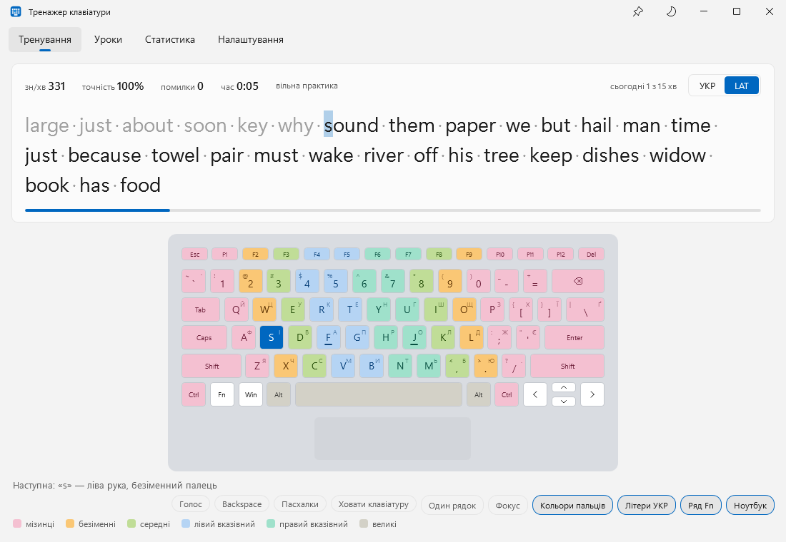

## Кнопки під клавіатурою

Найуживаніші перемикачі винесено під клавіатуру. Увімкнена кнопка обведена кольором акценту.

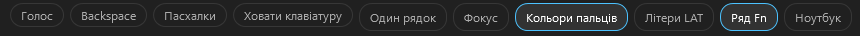

| Кнопка | Що вмикає |
|---|---|
| **Голос** | озвучення тексту вправи голосом Windows |
| **Backspace** | помилка друкується, і її треба стерти та набрати правильно |
| **Пасхалки** | на місці схованої клавіатури проявляється ілюзія або фрактал |
| **Ховати клавіатуру** | клавіатура згасає, коли немає помилок, і повертається при помилці |
| **Один рядок** | біжучий рядок: поточна літера по центру |
| **Фокус** | більший текст і приглушена клавіатура |
| **Кольори пальців** | кожна зона пальця свого кольору, внизу легенда (Ctrl+F) |
| **Літери LAT / УКР** | дрібні літери іншого алфавіту на клавішах (Ctrl+K) |
| **Ряд Fn** | ряд Esc, F1–F12, Del |
| **Ноутбук** | ноутбучна форма клавіатури замість стандартної |

Усі ці перемикачі є й на вкладці «Налаштування».

## Уроки і практика

Вкладка **«Уроки»**: ліворуч список, праворуч опис вибраного уроку і кнопка «Почати».

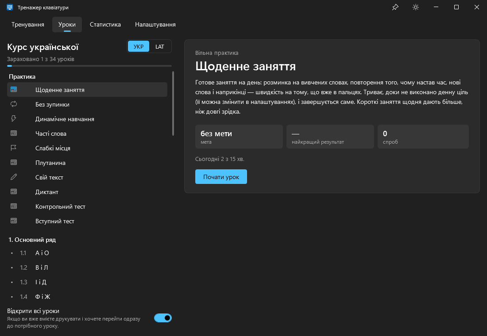

**Курс** — по 30+ уроків для української та латиниці: основний, верхній і нижній ряди, Shift і великі літери, особливі літери, цифри й знаки, ряд Fn, слова й речення, швидкість від 150 до 300 знаків за хвилину. Урок зараховується за точністю (типово 95%) і мінімальною швидкістю; наступний відкривається після попереднього (або все одразу — перемикач «Відкрити всі уроки» внизу списку).

Вправи складаються зі справжніх слів, найчастіших складів мови і вимовних псевдослів — без безглуздих наборів літер.

Після вправи програма показує підсумок: швидкість, точність, помилки, час, рівномірність ритму. **Enter** — далі, **Esc** — повторити.

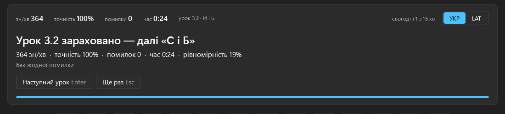

**Практика** (верх списку уроків):

| Пункт | Що це |
|---|---|
| Щоденне заняття | готова сесія на день, завершується сама |
| Без зупинки | нескінченний текст, що сам ускладнюється |
| Динамічне навчання | те саме короткими вправами |
| Часті слова | вільна розминка |
| Слабкі місця | вправа з ваших найпроблемніших клавіш і сполучень |
| Плутанина | вправа на літери, які ви натискаєте одна замість одної |
| Свій текст | будь-який вставлений текст або файл `.txt` |
| Диктант | друк на слух |
| Контрольний тест | чесний замір на 1, 3 або 5 хвилин |
| Вступний тест | для тих, хто вже друкує |

## Режими набору

### Біжучий рядок

Кнопка **«Один рядок»**. Один рядок тексту, поточна літера по центру, набране плавно відпливає ліворуч. Слова поруч чіткі, далекі — бліді.

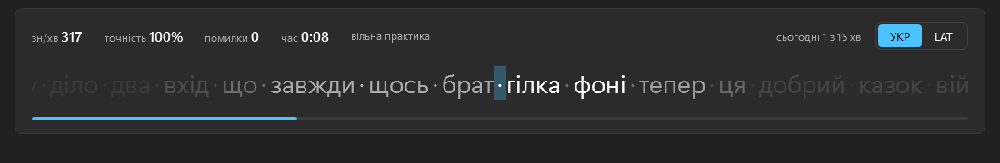

### Виправлення клавішею Backspace

Кнопка **«Backspace»**. Типово помилка зупиняє курсор, доки не натиснуто правильну клавішу. У цьому режимі помилкова літера друкується і позначається червоним, а на клавіатурі підсвічується Backspace: зітріть і наберіть правильно — як у справжній роботі. Вправа завершується, коли невиправлених помилок не лишилось.

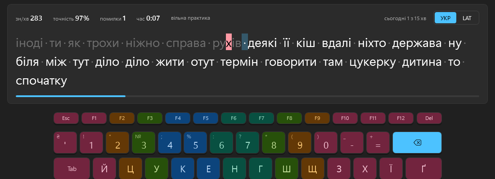

### Правильний Shift

Shift має бути на іншій руці, ніж літера. Програма розрізняє лівий і правий Shift і підказує, якщо натиснуто не той. У режимі **«Суворий Shift»** («Налаштування» → «Техніка і темп») не той Shift рахується помилкою.

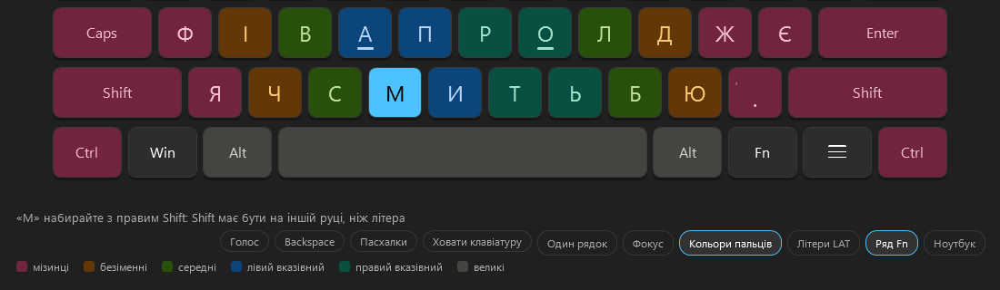

### Бігунок темпу і метроном

«Налаштування» → «Техніка і темп». Задайте **цільовий темп**; **бігунок** — підкреслення в тексті, що рухається з цією швидкістю (видно, випереджаєте ви темп чи відстаєте), **метроном** — тихий клац у цьому ж темпі. Якщо помилок стає забагато, програма радить сповільнитись.

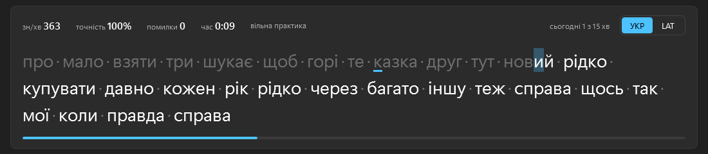

### Ховати клавіатуру і режим фокусу

Кнопка **«Ховати клавіатуру»**: після 8 чистих натискань клавіатура починає згасати і за наступні 20 зникає; помилка одразу повертає її з підсвіченою потрібною клавішею. Кнопка **«Фокус»**: більший текст і приглушена клавіатура.

## Розумне навчання

### Без зупинки і динамічне навчання

Програма сама підбирає слова від простих до складних. Починає з А і О, по одній відкриває літери, потім розділові знаки й велику літеру, і переходить на прості речення. Слово, яке кілька разів набрано без помилок і в рівному ритмі, стає вивченим і більше не показується; сполучення з помилками чи паузами повертаються на донавчання. Над текстом видно, скільки літер відкрито, яка зараз у роботі і що на донавчанні.

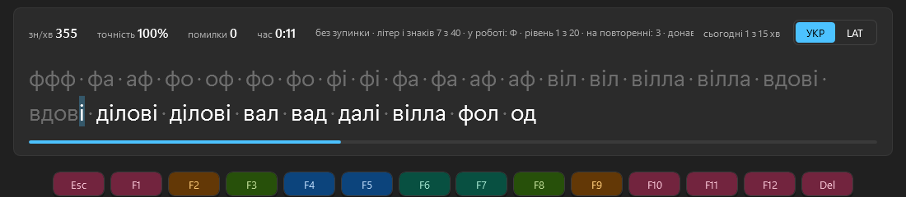

У «Без зупинки» текст не закінчується; кожні 10 хвилин (налаштовується) програма пропонує перерву. **Esc** завершує й показує підсумок.

### Інтервальні повторення

Вивчене повертається на перевірку через 1, 3, 7, 21 і 60 днів. Чиста перевірка подовжує інтервал, помилка повертає слово в навчання. Нічого вмикати не треба — це працює саме.

### Щоденне заняття

«Уроки» → «Щоденне заняття». Чотири фази: розминка → повторення → нове → швидкість. Триває до денної цілі (типово 15 хвилин, змінюється в налаштуваннях) і завершується саме. Над текстом — назва фази і скільки лишилось; праворуч — хвилини за сьогодні і серія днів поспіль.

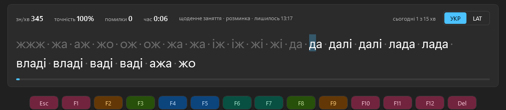

### Вступний тест

«Уроки» → «Вступний тест». Один текст, де кожна літера трапляється щонайменше тричі. Літери, набрані без помилок і довгих пауз, вважаються знайомими: вони відкриваються в динамічному навчанні, а відповідні уроки курсу зараховуються. Потрібні точність від 90% і швидкість від 60 зн/хв.

### Слабкі місця і плутанина

Програма записує не лише де сталася помилка, а й яку клавішу натиснуто замість потрібної, і визначає тип: сусідня клавіша, дзеркальна, переставлені літери, регістр. «Плутанина» будує вправу на найчастіших парах, «Слабкі місця» — на найповільніших і найпомилковіших клавішах.

## Перевірка себе

### Контрольний тест

«Уроки» → «Контрольний тест». Звичайні речення, що не підлаштовуються під вас; клавіатуру й підказки приховано; замість часу, що минув, показано, скільки лишилось. Зупиняється сам. Тривалість — 1, 3 або 5 хвилин («Налаштування» → «Техніка і темп»).

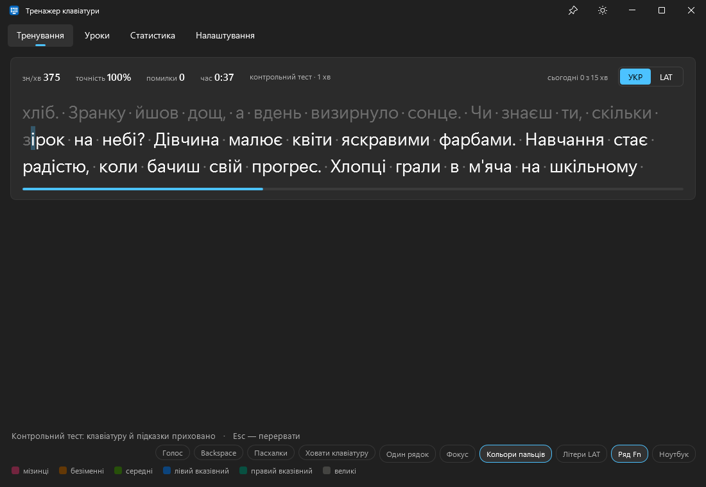

Результати зберігаються окремо, щоб порівнювати себе з собою місяць тому:

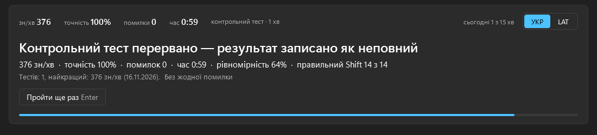

### Диктант

«Уроки» → «Диктант». Речення озвучуються, а ще не набраний текст приховано крапками. **Tab** повторює фразу; після трьох помилок на одному місці літера відкривається. Потрібен голос Windows для мови (які голоси знайдено — видно в налаштуваннях).

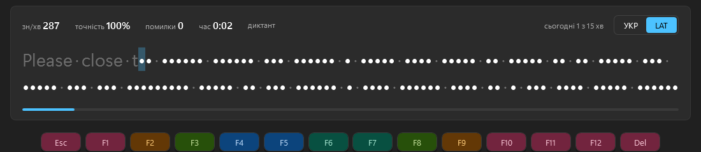

## Пасхалки

Кнопка **«Пасхалки»** (разом з нею вмикається «Ховати клавіатуру»). Коли клавіатура згасла, на її місці поступово проявляється картинка — щоб зайняти боковий зір і не відриватися від тексту.

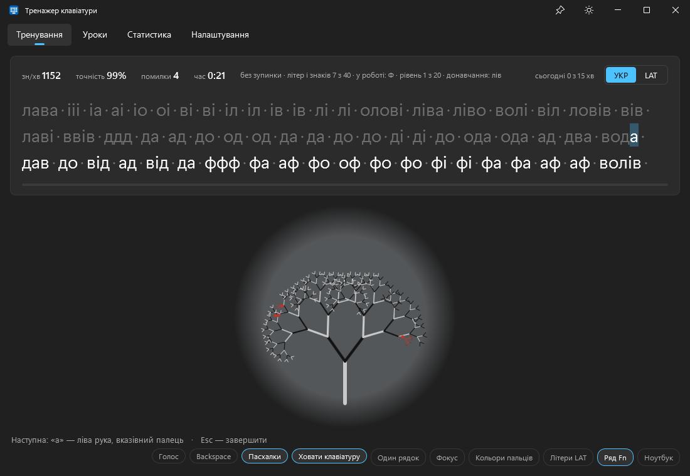

- **Оптичні ілюзії:** переплетені кільця, спіраль з кіл, стіна кафе, мерехтлива решітка, лінії Цьолльнера, сітка Герінга, кільця, що «обертаються».
- **Фрактали:** дерево, соняшник, сніжинка Коха, крива дракона. Фрактал росте по одному елементу на кожне натискання, а його форма залежить від швидкості й ритму.
- **Помилка лишає хворобу:** зламану червону гілку, шрам у візерунку, поворот не в той бік — і далі з цього місця фрактал росте неправильно. У момент помилки картинка на секунду показується поверх клавіатури. Чистий набір дає правильну фігуру.

Кожна нова вправа бере іншу картинку. Усе малюється кодом, без файлів з картинками.

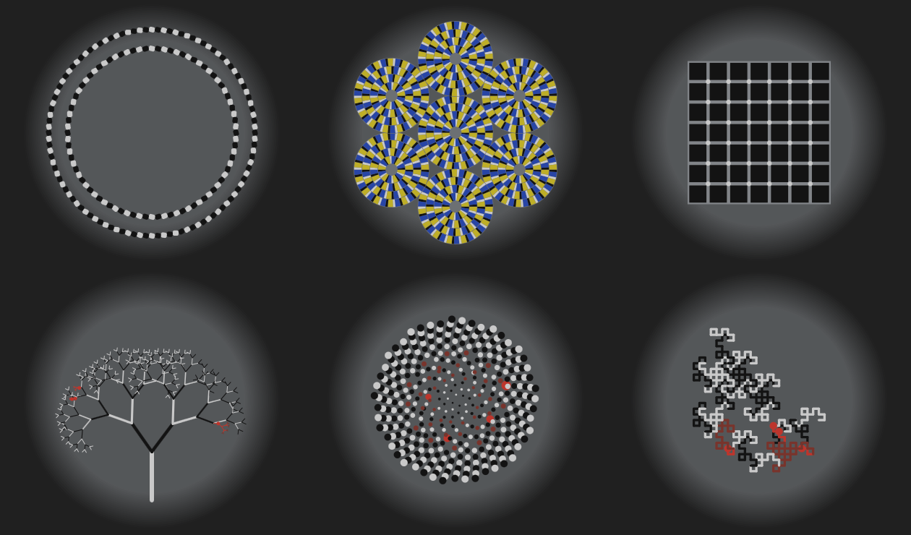

## Статистика

Вкладка **«Статистика»**: швидкість і точність по днях, теплова карта клавіатури (де помилки і які клавіші повільні), останні вправи, прогрес курсу й динамічного навчання. Праворуч угорі — період і розкладка.

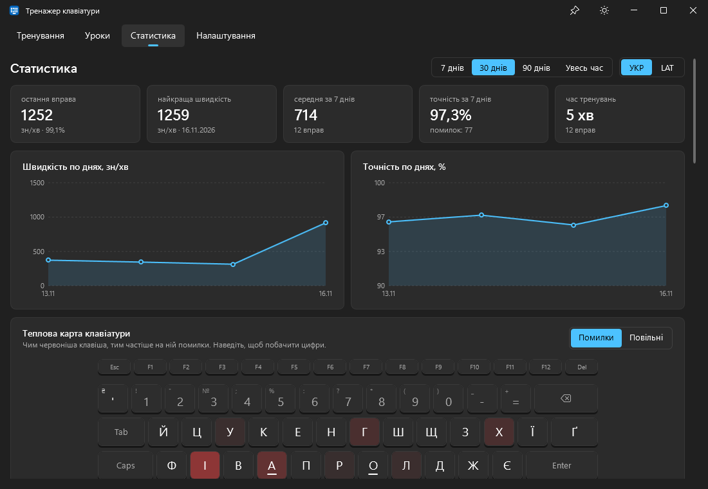

Нижче — блоки з висновками. У кожного своя кнопка, що одразу запускає потрібну вправу:

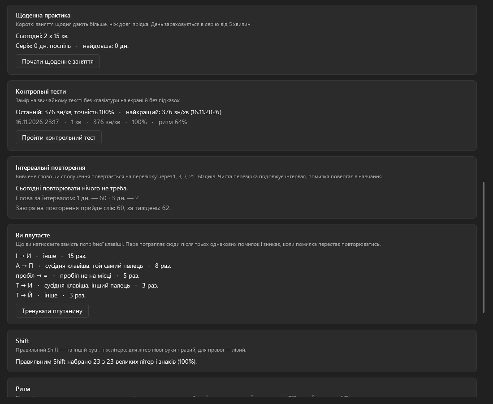

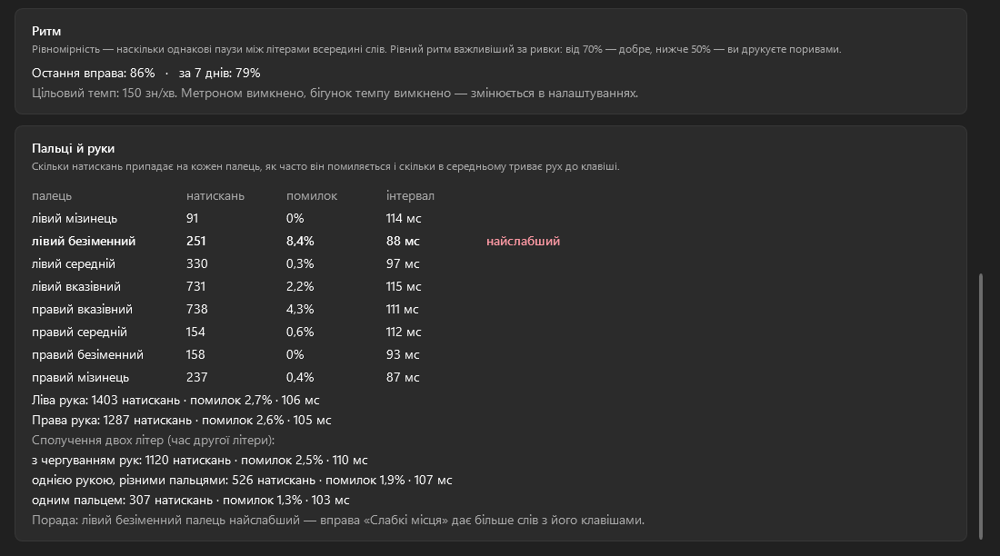

## Налаштування

### Вигляд

Тема (світла, темна, як у Windows), акцентний колір, розмір тексту вправи, біжучий рядок.

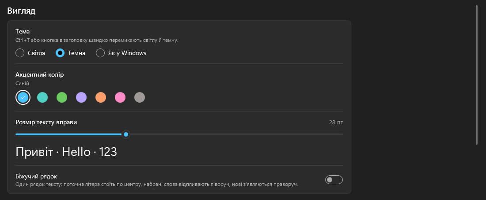

### Клавіатура

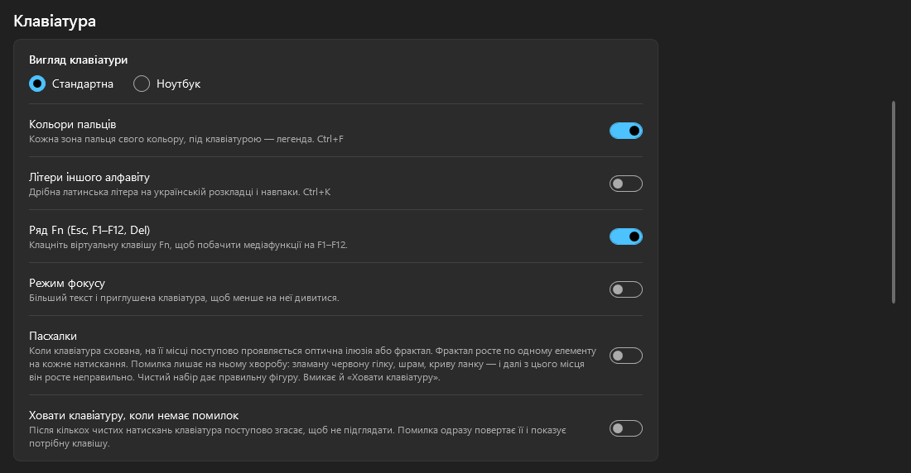

### Навчання

Одиниці швидкості, точність для зарахування уроку, відкриття всіх уроків, звук помилки, перерви в уроці «Без зупинки», озвучення.

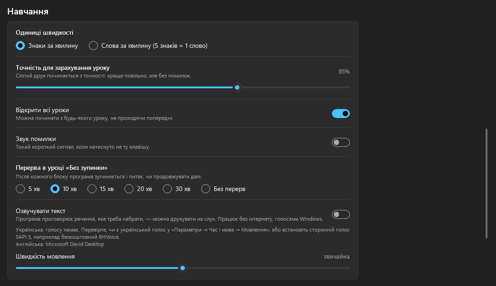

### Техніка і темп

Суворий Shift, режим Backspace, цільовий темп, метроном, бігунок, денна ціль, тривалість контрольного тесту.

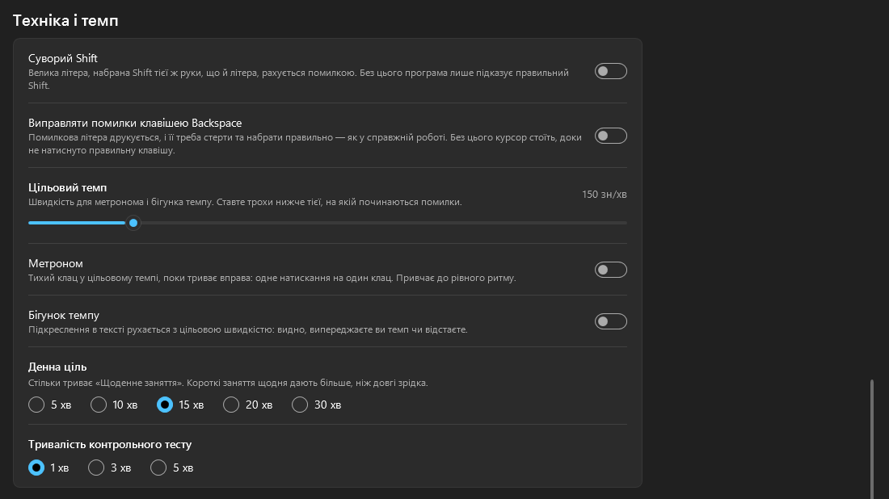

### Оновлення

При запуску програма перевіряє, чи є нова версія, і показує смужку з кнопкою «Завантажити»:

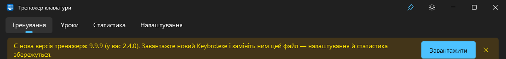

Вимикач і кнопка «Перевірити зараз» — у налаштуваннях:

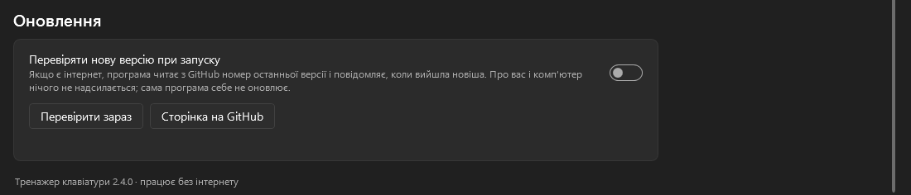

## Гарячі клавіші

| Клавіші | Дія |
|---|---|
| Esc | почати вправу заново; в уроках без кінця — завершити й показати підсумок |
| Enter | після вправи — наступний урок або новий текст |
| Backspace | стерти символ (у режимі виправлення) |
| Tab | повторити фразу (в диктанті) |
| Ctrl+P | закріпити вікно поверх інших / відкріпити |
| Ctrl+T | світла / темна тема |
| Ctrl+L | УКР / LAT |
| Ctrl+F | кольори пальців |
| Ctrl+K | літери іншого алфавіту |
| Ctrl+Tab | наступна вкладка |

## Файли, інтернет і приватність

Поруч з exe програма створює:

| Файл | Що в ньому |
|---|---|
| `config.json` | налаштування: тема, розкладка, вигляд клавіатури, поточні уроки, свій текст, розмір і положення вікна |
| `stats.json` | усі вправи (дата, швидкість, точність, ритм), прогрес уроків, статистика клавіш і пар літер, пари «треба → натиснули», правильність Shift |
| `mastery.json` | «м'язова пам'ять»: для кожного слова і сполучення — оцінка вивченості, спроби, середній інтервал, день наступного повторення |
| `default_text_uk.txt`, `default_text_en.txt` | ваш типовий текст для «Свого тексту» (з'являються після кнопки «Зробити типовим») |

Якщо в папку з exe не можна записувати (наприклад, `Program Files`), файли зберігаються в `%APPDATA%\Keybrd`, і програма про це повідомляє. Пошкоджений файл не ламає програму: його копія зберігається як `*.bak.json`.

Тренажер повністю працює без інтернету. Єдине звернення в мережу — перевірка нової версії при запуску: програма читає з цього репозиторію файл `dist/version.txt` і порівнює номер зі своїм. Про вас і комп'ютер нічого не надсилається, сама програма себе не оновлює. Перевірку можна вимкнути.

Клавіші розпізнаються за фізичним розташуванням, тому тренажер працює правильно навіть тоді, коли у Windows увімкнена інша розкладка.

## Збірка з коду

Потрібен .NET SDK 6 або новіший (перевірено з 8.0). Під час першої збірки потрібен інтернет, щоб завантажити референсні збірки .NET Framework 4.8.

```
powershell -ExecutionPolicy Bypass -File build.ps1
```

Скрипт кладе готовий файл у `dist\Keybrd.exe` і записує номер версії в `dist\version.txt`. Іконку можна перегенерувати: `pwsh -File tools\make-icon.ps1`.

Структура коду:

- `src\Keybrd\Core` — логіка: розкладки й пальці (`KeyboardLayout`), вправа (`TypingSession`), уроки (`Lessons`), генератори текстів (`ExerciseGenerator`, `DynamicTrainer`, `SentenceBuilder`, `LanguageModel`), модель вивченості (`Mastery`), статистика (`StatsStore`, `Confusions`), вступний тест (`Placement`), налаштування (`AppConfig`), теми (`ThemeManager`), перехоплення клавіш за скан-кодом (`KeyInput`), перевірка оновлень (`Updater`).
- `src\Keybrd\Controls` — віртуальна клавіатура (`KeyboardView`), графік (`LineChart`), пасхалки (`EggView`).
- `src\Keybrd\Pages` — вкладки: Тренування, Уроки, Статистика, Налаштування.
- `src\Keybrd\Data` — словники, речення й типові тексти (вбудовуються в exe).
- `docs\img` — знімки для цієї сторінки.
- `SPEC.md`, `SPEC-2.md` — специфікації.

Технології: C#, WPF, .NET Framework 4.8. Жодних сторонніх бібліотек.

## Ліцензія

[MIT](LICENSE): програмою та її кодом можна вільно користуватись, змінювати їх і поширювати, зберігаючи зазначення автора.

Ліцензія стосується коду програми. Типові тексти для вправи «Свій текст» (`src\Keybrd\Data\default_uk.txt`, `default_en.txt`) — чужі твори, вбудовані як зразки для набору; ліцензія програми на них не поширюється.
